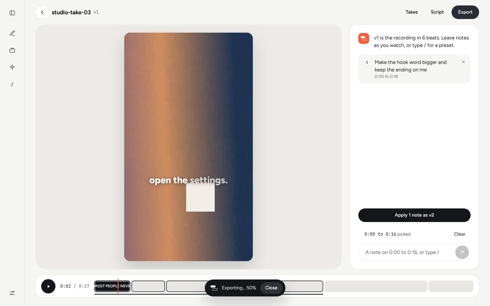
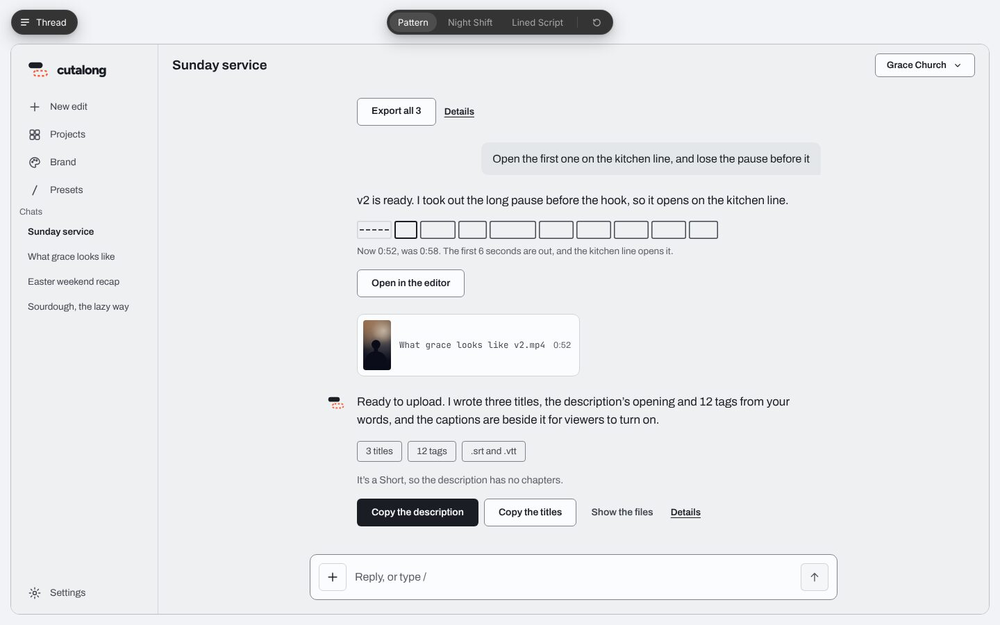
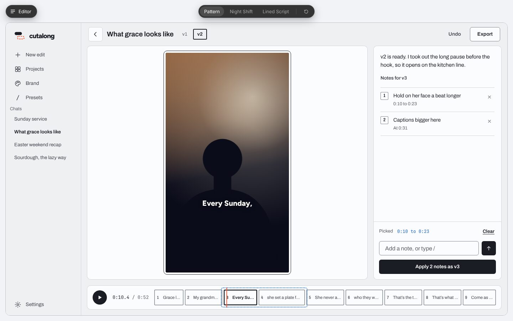
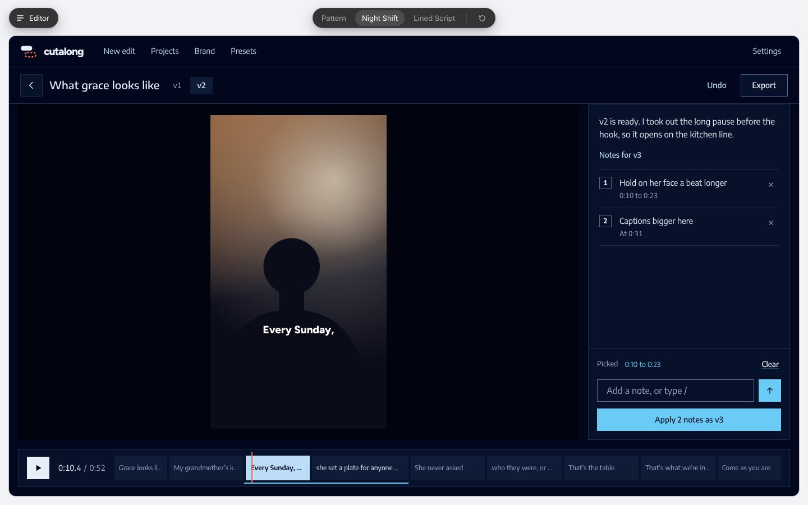
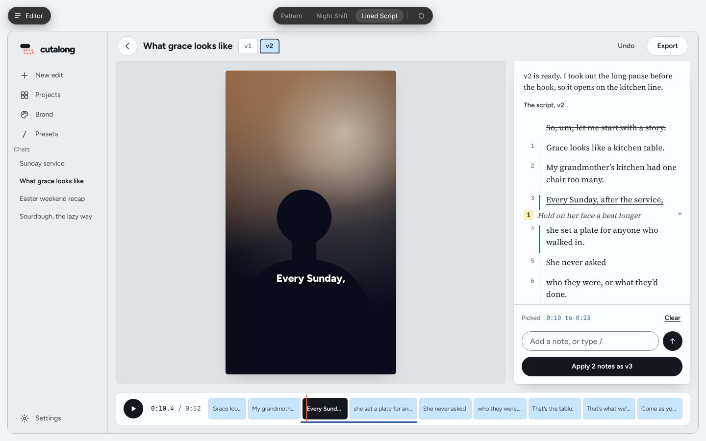
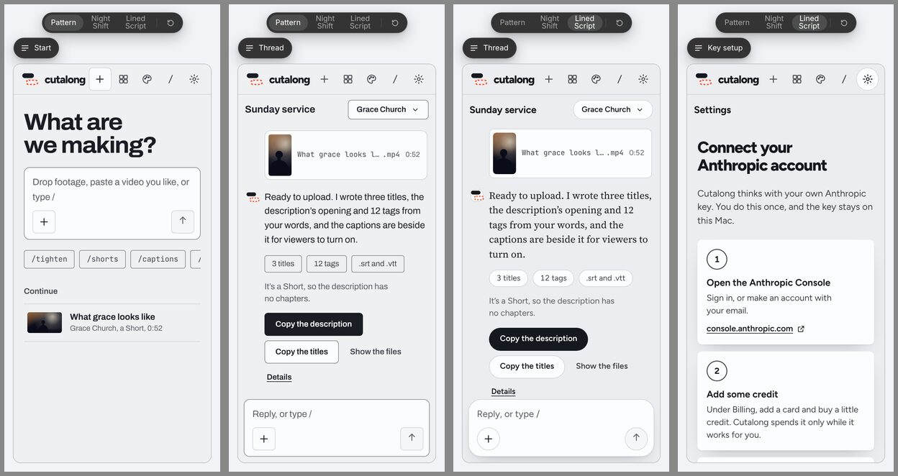

# Cutalong redesign: audit and three directions

An audit of Cutalong as it stands at `6ffa7e7` (brands per channel, never lists, B-roll sources and the upload kit), three whole-product directions, a clickable prototype of each, and a recommendation.

- Prototype: [`prototype/index.html`](prototype/index.html), published as a private page at https://claude.ai/artifact/DsAoHBLs2CaKPbJZ1supKG (the owner can share it from the page's Share menu). The file is an Artifact page, so it has no document skeleton; the host adds one.
- Screenshots: [`shots/`](shots/). `now-*` are the app today, served from `out/renderer` with generated footage. `proto-*` are the prototype. No footage from anyone else appears anywhere.
- Motion fixes for today's app: [`animation-plans/`](animation-plans/), five small plans other builders can apply.

Nothing in `src/` was changed.

## The short version

**What is wrong today, most important first**

1. At the smallest window (960 by 640) with the rail open, the editor shrinks the video to a sliver. The thing creators came to see loses to chrome.
2. The export toast lands on top of the beat strip, the one place your eyes are while you work.
3. Coral is spent four or more times on a screen: an avatar tile on every reply, the composer's focus glow, the mark and the playhead. The brand's own rule is "A screen with two coral things has one too many", so coral has stopped meaning anything.
4. Key setup is a sentence with an unlinked address, and a wrong key wipes the field and says so in grey. There is no error colour anywhere in the system.
5. Versions are invisible: the editor says `v2` in its header and offers no way to see or go back to v1.
6. The Brand page is a wall of sections that never says which brand you are editing, repeats its own copy, and nests drop zones.

**Three directions**

- **Pattern** takes the brand's own idea, "cut along the dotted line", and makes it the grammar. Lines carry state: a dashed line means cut, a dotted tracing means picked, and coral means now (the playhead, or the cut while work runs). Light by default, with a real dark theme.
- **Night Shift** is a dark broadcast room where the footage is the only light, every claim comes with proof of what changed, screens cut instead of sliding, and coral survives only as the playhead.
- **Lined Script** treats the transcript as a shooting script: replies read in a serif, the editor's side panel is the script with coverage lines and pencilled notes, and versions are revision pages in the industry's colours.

**Recommendation: build Pattern**, borrowing Night Shift's proof strip (already in the Pattern thread) and Lined Script's script panel as the editor's Script tab. Pattern extends the identity Cutalong already has instead of replacing it, fixes coral by giving it one meaning, keeps the light theme current users know, and is mostly a token and component change. The full change list is at the end.

## What was built: Lined Script, heavenly and alive

The owner chose **Lined Script**, and asked for it to look heavenly and then to feel alive, "like agents working for you". It is built across the app (`src/renderer/src/cutalong`); `.claude/skills/cutalong-ui/SKILL.md` is the working guide and the design system page holds the tokens.

- **Lined Script.** Luminous paper and a soft light from above, a calm night page after dark; replies and the script in Source Serif 4 (bundled); versions as revision pages with a tab each and an asterisk on every changed line; notes pencilled in the script's margin.
- **Colour you can feel.** The revision colours come three ways: gentle page tints behind the script and the strip, confident pastel blocks (a version's tab, fact tiles, clip cards, the brand's hero, crew cards, an empty page) and a deeper bloom for shapes. Colour sits around the footage, never on it, and coral stays the cut.
- **Type with a voice.** Big, tight display headings with one word in the serif's italic: "What are we *making*?"
- **Shapes with character.** Thirteen shapes drawn by code (`shapes.ts`): stickers ("new" on a version made while you watched) and each brand's own avatar, picked as a shape and a colour on the Brand page, with a morph as you choose.
- **A living mark and a crew.** While long work runs, the mark becomes a soft, iridescent blob that breathes, and the crew who do the work line up under it: Echo (sound), Snip (the cut, in coral), Quill (words on screen), Scout (finding things), Tint (the look) and Reel (getting it out), each joining only for a stage the app really reports, saying what they are doing and hopping once when done. A reply credits them in one quiet line; notes say who picks them up; the Crew page shows what each has learned from your brand and what each needs.
- **Motion that lands.** Arrivals settle on a spring with a hair of overshoot; dropped footage floats up into the composer as round stills; leaving never bounces; only work in progress moves on its own. Reduced motion keeps the fades and nothing else.

## How the audit was done

- **Capture.** I built the renderer (`npx electron-vite build`), served `out/renderer` with stubbed services and a generated 40 second clip (gradients and a moving square), and drove it with Playwright at 1440 by 900, 1280 by 840 and 960 by 640: 115 screenshots across Start, the slash menu, a dropped file, working, replies with chips, buttons and Details, the inspiration reply, the clip set, the editor playing, a picked stretch, notes, script and takes, export toasts, the upload kit, Projects, Presets, Brand (two brands, a long name, never list and B-roll sources), the brand switch menu, Settings and a wrong key, with the rail open and closed, long file names, and dark mode requested. I also reviewed the phone build's screenshots and the real-app end-to-end screenshots (those contain the owner's footage, so none are reproduced here).
- **Motion.** Every transition was stepped the way the cutalong-ui skill describes: pause `document.getAnimations()` and read frames at 0, 12, 25, 40, 60, 80 and 100 percent, with and without reduced motion. Playback was timed with `requestAnimationFrame` (p95 16.7 ms, no long tasks).
- **Detectors.** Impeccable's detector ran live against each screen through a DevTools port (`detect --cdp`), because it cannot parse TSX and a plain URL scan only sees Start. Hallmark's lint recorded the app (`--before`) at 1280, 1440, 1920 and 375 wide.
- **Reviews.** Each skill's own method, below: Impeccable's critique, audit and shaping; Hallmark's redesign mode; Emil Kowalski's review, improve, find, remove, choreograph, animate, apple-design, break-ui, mobile-native, animation-performance and prototype skills; make-interfaces-feel-better's full review.

## Findings, ranked

P1 hurts a creator in the middle of an edit. P2 is a real flaw most people will meet. P3 is polish. Each finding names the principle it breaks and which skill raised it.

### P1

**1. The smallest window crushes the video.** At 960 by 640 with the rail open, the preview is about a fifth of the window ([`now-editor-960-rail-open`](shots/now-editor-960-rail-open.jpg)). *Principle:* the content is the interface; chrome gives way first (Impeccable, Operate mode; Hallmark app-screen scope). *Fix in every direction:* below 940 wide the rail drops to icons and the notes panel narrows to 280 px but stays beside the video; only a phone stacks.

**2. The export toast covers the beat strip.** It sits bottom centre at 760 px wide, exactly over the strip ([`now-editor-export-toast`](shots/now-editor-export-toast.jpg)). *Principle:* never cover the working surface with a status message (Emil, toasts; make-interfaces-feel-better, spatial consistency). *Fix:* toasts sit at the top right of the window, carry their own progress, and leave in 4 seconds.

**3. Coral means everything, so it means nothing.** Every reply gets a coral avatar tile, the composer glows coral on focus, the mark is coral, the playhead is coral ([`now-thread-reply`](shots/now-thread-reply.jpg), [`now-editor`](shots/now-editor.jpg)). The brand guidelines say "Coral is never text and never a button fill. A screen with two coral things has one too many." *Principle:* one accent, one job (Impeccable colour rules; Hallmark theme discipline). *Fix:* each direction gives coral one meaning; Pattern's is "now".

**4. Key setup fails the people who need it most.** Settings says "You can make one at console.anthropic.com." as plain text. A wrong key clears the field, so you cannot see what you pasted, and the message is grey because the system has no error or success colours ([`now-settings-wrong-key`](shots/now-settings-wrong-key.jpg)). *Principle:* error recovery and help (Nielsen 9 and 10); field states need three channels (Hallmark 39a, 40). *Fix:* a four-step key screen with a real link, the paste field keeps its text, the message uses an error colour and an icon, and success says where the key lives.

**5. Versions are invisible.** The editor header shows `v2` as text. There is no way to see v1, compare, or go back except Undo ([`now-editor`](shots/now-editor.jpg)). *Principle:* recognition over recall (Nielsen 6); version control is the core loop of a chat editor. *Fix:* a versions control in the header (v1, v2, v3) that switches the preview, with each new version arriving visibly.

**6. The Brand page never says which brand you are in.** Two brands share one long page; the switcher scrolls away; sections repeat each other's explanations; drop zones sit inside sections that are themselves drop zones ([`now-brand`](shots/now-brand.jpg), [`now-brand-long-name`](shots/now-brand-long-name.jpg), [`now-brand-never-sources`](shots/now-brand-never-sources.jpg)). *Principle:* orientation and cognitive load (Impeccable critique; Nielsen 1 and 8). *Fix:* the brand switcher is sticky at the top of the page with the brand's name in the lede, one drop target, page title at a real size.

### P2

7. **A question with no way to answer it.** Replies that end with a question offer no buttons, so the answer has to be typed (Impeccable, chat-first patterns).
8. **The composer's focus is nearly invisible.** The textarea removes its outline; the only cue is a 6 px coral glow at low opacity (Hallmark 26a: "nothing shows keyboard focus on textarea"). *Fix:* a 2 px ink ring on the composer.
9. **Beat labels are uppercase and clipped.** `beatLabel()` returns `.toUpperCase()`, set at 11 px with no wrap, so most labels are clipped capitals (make-interfaces-feel-better, type; Impeccable's craft floor bans tracked caps). *Fix:* sentence case, 12 px, ellipsis, with the beat number in front in Pattern.
10. **No dark theme.** Asking the browser for dark still renders light ([`now-start-dark-requested`](shots/now-start-dark-requested.jpg)). Editors work at night. *Fix:* Pattern and Lined Script ship light and dark; Night Shift is dark in both.
11. **Two primaries, and stale ones.** Older replies keep their filled button after newer replies arrive, and the editor shows Export and Apply as primaries together ([`now-clip-set`](shots/now-clip-set.jpg), [`now-editor-notes`](shots/now-editor-notes.jpg)). The cutalong-ui rule is one primary per view. *Fix:* only the newest reply holds a primary; in the editor, Apply is primary while notes wait and Export takes over after.
12. **Motion faults** (detail under Emil's skills): the slash menu animates when "/" is typed; exits use an ease-in curve; staggers step evenly; switches overshoot on a tap; beat blocks lift on hover; the thread scrolls smoothly even with reduced motion; reply avatars scale in on top of the reply's own entrance.
13. **The composer double-exposes on the way to the thread.** Old and new composer images cross-fade at once, so both texts show at 25 percent (stepped frame `start-to-thread/t025`). *Fix:* the old contents empty in 90 ms before the new fill in from 100 ms.
14. **Colour outside the tokens.** 35 colour literals outside the tokens, nearly all in `cutalong.css` (Hallmark 48), no state colours, and placeholder text at `#757575`, 4.2:1, under the 4.5:1 it needs.
15. **Field edges at 1.04:1, disabled by opacity alone.** Inputs nearly vanish on the ground colour (Hallmark 40) and disabled buttons only fade (Hallmark 39a).
16. **Hover that sticks on touch.** 14 hover rules are outside a hover media query, so the phone build keeps hover colours after a tap (mobile-native).
17. **Details set in monospace.** `.cl-details dd` is JetBrains Mono, so descriptions and titles read as code (Impeccable bans mono as costume; mono is for commands and file names).
18. **Unthemed browser surfaces.** No `::selection`, `caret-color` or scrollbar colours (make-interfaces-feel-better).
19. **Long names.** Brand names and file names truncate from the end, losing the extension or the distinguishing part ([`now-long-file-name`](shots/now-long-file-name.jpg)). *Fix:* keep the extension, truncate the middle of the name.
20. **Phone build:** a stray dot, raw ids where names should be, and a chip orphaned on its own line (phone reference shots).
21. **Page widths jump** between Start, the thread and Settings, so the column moves under your eye.
22. **The rail's Chats repeat Start's Continue list** when the rail is open.
23. **The mark is missing from Start** when the rail is closed, so the first screen has no identity at all.

### P3

24. Dead CSS: two width and flex-basis transitions in `cutalong.css` are overridden by `motion.css` (Hallmark 10a).
25. Stragglers: single words alone on the last line of asides (Impeccable detector).
26. "Continue" is a styled div, not a heading.
27. A middle dot in the working line ("Thinking · 42s") and in link cards.
28. The picked beat and the playing beat are both ink, so you cannot tell them apart.
29. The brand switch menu does not take focus, has no arrow keys and does not return focus on Escape.
30. `watchSegments` observes class changes on the whole body subtree to keep pills in place; a scoped observer would do.

**What is already good and stays:** the voice (plain, specific, first person, no jargon); the motion engineering (view transitions that carry the composer and the footage, an interruptible sliding pill, `collapse()` for removals, one `--cl-travel` switch for reduced motion); the inspiration reply; the clip set row.

## By skill

### Impeccable

> DEGRADED: single context. No sub-agent tool was available, so the critique's independent reviewers, the finish reviewer and the motion reviewer ran in this one thread. Their verdicts are mine, written in their formats.

- **Product truth.** With no way to ask the owner questions, I inferred `PRODUCT.md` from the brief, the repo and the brand guidelines: chat-first, local-first, for YouTube creators who edit a lot; calm so the video is loud; platform: desktop web view (Electron) and a phone build. Kept in the scratchpad, not committed.
- **Critique (Operate mode).** Nielsen scores, 25 of 40:

| Heuristic | Score | Why |
| --- | --- | --- |
| 1 Visibility of system status | 3 | The working line and stopwatch are good; versions are invisible |
| 2 Match with the real world | 3 | Creators' words (beats, takes); uppercase labels and raw ids on phone |
| 3 User control and freedom | 2 | A wrong key wipes the field; no way back to an older version except Undo |
| 4 Consistency and standards | 2 | Two primaries, page widths that jump, coral with five meanings |
| 5 Error prevention | 3 | The key's provider is detected before saving |
| 6 Recognition over recall | 2 | Versions hidden, presets only through "/", brand context missing |
| 7 Flexibility and efficiency | 3 | Slash commands, keyboard picking on the strip |
| 8 Aesthetic and minimalist design | 3 | Calm overall; the Brand page is a wall |
| 9 Recognise and recover from errors | 2 | Good wrong-key copy, but no error colour and the evidence is erased |
| 10 Help | 2 | Key setup is one unlinked sentence |

  Cognitive load is low in the thread, moderate in the editor, high on Brand. Three personas carried the review: the weekly church media volunteer with an hour on Sunday afternoon, the daily creator who lives on the keyboard, and the first-run creator who has never made an API key.
- **Audit health, 12 of 20:** accessibility 2 (placeholder contrast, field edges, invisible composer focus, menu focus), performance 3 (smooth playback; a body-wide observer), theming 2 (light only, literals, no state colours), responsive 2 (the minimum window; sticky hover on phone), integrity 3 (tokens mostly respected; dead CSS).
- **Detector on the app:** Start, editor, Projects and Presets clean; the thread had a straggler; Brand 8 and Settings 9 findings, nearly all low-contrast placeholders and fields, plus stragglers. **On the prototype: 0 findings on all 24 screens** (8 screens in 3 directions), after fixing what it found in earlier drafts: an overused face (Night Shift moved from Mona Sans to Encode Sans), striped fills, a flat type scale, and notes drawn as cards inside a card.
- **Design specificity.** Today's look is close to Hallmark's catalogue "Coral" theme: neutral greys, one warm accent, pills. Its only owned elements are the mark and the beat strip. Every direction below starts from that.
- **Shaping (new work, world first).** Seven grounded candidates, each from a real object in the creator's world: 1 a lined script with revision colours; 2 a contact sheet with china-marker selects; 3 a night broadcast rundown with tally lights; 4 a mixtape J-card; 5 a workprint trim bin and grease pencil; 6 the grammar of a thumbnail; 7 "cut along the dotted line", the brand's own idea. The concept-seed roll ran before I had written my list down, which the method does not intend; I kept the list as written and ranked by resonance, which put the literal brand reading last. Verdicts: 1 wins (Impeccable's pick: Lined Script); 3 is competitive and became Night Shift with Hallmark's dealt theme; 7 is built as Pattern because it is the identity the guidelines already promise, taking raises from three declined challengers (a lexicon of edit marks, orienteering lines, darkroom safelight). Competitive but not built: the J-card, a transit map, and a monochrome canon. The canon card stays as the standing exit: if all three feel wrong, a monochrome pro-editor look is the safe fallback.

### Hallmark

- **Redesign mode, full depth, app-screen scope.** The before record of the app: 65 FAIL, 69 REFLEX, 7 WARN. The failures that matter: 35 colour literals (48), 9 raw spacing values with tokens available (24a), 4 disabled states by opacity alone (39a), no visible keyboard focus on the composer (26a), field edges under 3:1 (40), `overflow-x: hidden` on body (34). Dismissed with reasons: 7a (pure black and white are the video dip-to-black and dip-to-white, correct as footage colours), 33 (the icons are `aria-hidden` through spread props, which the lint cannot see), 64 (monospace on slash commands is right: they are commands). The two 10a failures are the dead CSS in P3.
- **Theme deal.** Hallmark dealt Midnight (2 of 3) for a chat-first video editor: that became Night Shift, with proof strips taken from the monochrome canon. Impeccable's detector then flagged Midnight's Mona Sans as overused, so Night Shift uses Encode Sans at the same width and weight; this is the one place the two skills disagreed, and the detector won.
- **The prototype, linted:** 0 FAIL, 0 REFLEX, 3 WARN. The warnings are the harness: the picker's glass pill and its pill-shaped parts, which come from the prototype skill's spec. Two waivers, both in the stylesheet with reasons: 37 (five families in one file, because three directions share it; each uses at most three) and 39b (a project row is a 64 px list item whose whole row is the target). Getting there meant snapping 116 spacing values to the 4 px scale, three-channel disabled states, clip-path instead of width and left transitions, and 3:1 field edges.
- **Kept check:** not comparable yet. `--kept` compares a redesign against the before record of the same target, so it runs when the chosen direction is built in `src/`. The record is in the scratchpad (`.hallmark/before.json`: 182 handlers, 1 field).

### Emil Kowalski's skills

**review-animations** (today's app):

| Before | After | Why |
| --- | --- | --- |
| Slash menu: 180 ms scale and translate when "/" is typed | Appears in the same frame | Never animate what the keyboard started |
| Toast and note exits on `cubic-bezier(0.4, 0, 1, 1)` | `cubic-bezier(0.23, 1, 0.32, 1)`, 120 ms | Exits ease out and are shorter, never ease in |
| Reply parts every 40 ms, lists every `/ 8` | 0, 50, 90, 120, 140 ms, capped | Shrinking overlaps read as one motion |
| Avatar scales from 0.8 on every reply | No scale | One entrance per container |
| Toggle knob on a spring that overshoots to 1.037 | Ease-out, no overshoot | Bounce needs momentum; a tap has none |
| Beat blocks lift 2 px on hover | No lift; label colour only, behind a hover query | Nothing moves under a dragging pointer |
| `scrollIntoView({ behavior: 'smooth' })` always | `auto` under reduced motion | Reduced motion means everywhere |
| Composer old and new images cross-fade together | Old out in 90 ms, new in from 100 ms | No double exposure in a shared element |

Verdict: the system is well built (view transitions, interruptible pill, one travel switch) and badly tuned in a handful of places. Nothing needs rewriting; five small plans fix it.

**improve-animations:** the plans in [`animation-plans/`](animation-plans/), stamped with `6ffa7e7`, ordered by value: keyboard menus, exits, staggers, hover, less motion.

**find-animation-opportunities** (proposals, all in the prototype): a new version arriving in the versions control (a 220 ms rise, so you see v3 appear); the proof strip under "v2 is ready" showing what moved; a copy confirmation that keeps the button's width ("Copied" with a check, 1.6 s); a dropped clip dimming in place with Keep where Drop was; the brand switch confirming in a toast. Rejected: anything on the strip while scrubbing, animated counters, and entrance motion on Settings.

**remove-animations** (report only, nothing removed from `src/`): the avatar scale-in, the rail labels' per-item stagger, the project list stagger inside a screen change, and the beat hover lift.

**choreograph:** the reply arrival is one gesture: the sentence leads, facts follow at 50 ms, the clip row at 90 ms, actions at 120 ms, all within 360 ms, all ease-out 220 ms. Start to thread is one move: the composer carries down while the rest of the window cross-fades (old out in 120 ms, new in from 80 ms), the first message is already in place when the composer lands, and the working line arrives at 380 ms, after the move.

**animate** (decisions for the directions, in order): should it animate (only arrivals, screen changes, progress and state swaps); purpose (orientation and continuity); tool (CSS transitions and `@starting-style`, view transitions for screens, keyframes only for progress loops); properties (opacity and transform, clip-path for the picker and the cut line); curve and duration (ease-out 220 ms arrivals, 120 ms presses, ease-in-out 300 ms for shared elements); interruption (transitions, so a second click retargets); exit (shorter than the entrance).

**apple-design:** spatial consistency (the footage grows from the poster you clicked into the preview and shrinks back on the way out); materials by lightness, not blur, inside the app; reduced motion keeps opacity and drops travel. **break-ui** (worst case, toggled in the prototype under Screens, Try, Worst-case names): long thread titles, brand names and file names all truncate cleanly; file names keep their extension; the brand switch caps at 260 px; clip titles clamp at two lines. **mobile-native:** 16 px inputs so the phone does not zoom, hover behind a pointer query, safe-area padding, `touch-action: manipulation`, no tap highlight, a top bar instead of a rail under 640 px, and dynamic viewport units for the window. **animation-performance:** only transform, opacity and clip-path animate; the prototype's footage repaints at 30 frames a second from cached still layers and the strip reads its geometry once. Frame times on this machine are not trustworthy (load average about 45 on 4 cores: idle p95 33 ms, playing p95 100 to 133 ms); the check belongs on the owner's Mac. **prototype:** the picker is the skill's spec, with two deviations: the highlight slides by `clip-path` instead of `width` (Hallmark forbids layout transitions; same 250 ms and curve), and the choice persists in the hash (`#pattern-editor`), because the published page keeps only the hash. `?v=2` still works locally.

### make-interfaces-feel-better

| Principle | Today | Severity | In the directions |
| --- | --- | --- | --- |
| Concentric radius | The composer's 22 px corner sits 14 px from full-pill buttons; concentric would be 8 px | Low | Radii follow padding (Pattern 10 outside, 6 inside) |
| Shadows vs borders | Fields drawn with a 1.04:1 border | High | 3:1 field edges; borders for structure, one shadow for floating things |
| Press feedback | Scale 0.96 on press, good | Keep | Kept at 0.96, off under reduced motion |
| Tabular numbers | Set in one rule only | Low | `tabular-nums` on every time and count |
| Text wrapping | No `text-wrap` rules; stragglers in asides | Low | `text-wrap: balance` on headings, `pretty` on prose |
| Icon stroke | Strokes of 1.9, 2 and 2.2 px in one set | Low | One set at 1.75 px |
| Media | Four videos render with no poster frame (Hallmark 28b) | Low | Every clip shows a poster; Pattern outlines the preview |
| Hover | Ungated, sticks on touch | Medium | Behind `(hover: hover) and (pointer: fine)` |
| Enter and exit | Ease-in exits, even staggers | Medium | See the animation plans |
| Browser surfaces | No selection, caret or scrollbar colours | Low | All three themed per direction |

## Three directions

The prototype keeps one set of screens and copy and changes only the world around them. Open it, pick a direction at the top (or press 1, 2, 3; arrows cycle; R replays the screen's motion), and use Screens at the top left for Start, Thread, Editor, Key setup, Settings, Brand, Projects, Presets and Phone, plus the look (match the computer, light, dark), Less motion, worst-case names, and a wrong or saved key. Each direction covers the new brand surfaces: the brand switch in a chat's header, the upload kit reply with chips, Details and Copy buttons, the never list and B-roll sources.

### Pattern

**Point of view.** Cutalong already has a sentence for itself: cut along the dotted line. Pattern makes it the product's grammar, the way a sewing pattern is a sheet of lines that tell you what to cut and in what order. Surfaces stay plain; lines carry every state. A beat is an outlined, numbered piece; the stretch you picked is traced with a dotted line; a removed stretch is a dashed rule in the proof strip; the playhead is the one coral line, because coral means now. Nothing is filled except footage and the one action that matters. It reads like a precise tool, light by default, with a dark theme that keeps the same lines.

| Token | Light | Dark |
| --- | --- | --- |
| Desk, sheet, sheet 2 | `oklch(95.4% .004 255)`, `oklch(99.2% .002 255)`, `oklch(97.2% .003 255)` | `oklch(19% .012 260)`, `oklch(23% .013 260)`, `oklch(27% .014 260)` |
| Rule, rule 2 | `oklch(87% .006 255)`, `oklch(61% .01 255)` (3:1 field edges) | `oklch(34% .014 260)`, `oklch(58% .014 260)` |
| Ink, ink 2, muted | `oklch(23% .014 265)`, `oklch(40% ...)`, `oklch(49% ...)` | `oklch(94% .006 255)`, `oklch(83% ...)`, `oklch(72% ...)` |
| Cut (coral) | `#ff5a36` | `#ff6a4a` |
| Trace (picked), error, ok | `oklch(52% .17 258)`, `oklch(51% .18 25)`, `oklch(49% .11 155)` | `oklch(74% .13 255)`, `oklch(74% .15 25)`, `oklch(77% .12 155)` |

- **Type:** Archivo with its width axis. Interface 15 px at normal width; display 56 px, weight 720, width 106, tracking -0.035em; numbers for beats, steps and notes at width 75, so they read as pattern numbering. JetBrains Mono for commands and file names only. The wordmark stays Figtree ExtraBold.
- **Space:** a 4 px scale (4 to 64). **Radius:** controls 6, surfaces 10, chips 4, frames 4. **Elevation:** none on surfaces; one float shadow for menus and toasts.
- **Motion:** arrivals ease out over 220 ms, overlapping at 0, 50, 90, 120 and 140 ms; presses 120 ms; shared elements 300 ms ease-in-out; while work runs, the cut line's dashes march ahead of a solid take that grows with progress. Less motion sets travel to zero: things fade in place.
- **Mark and coral:** the mark is unchanged and sits at the top of the rail. Coral appears only as a line: the playhead, the cut line while work runs, and the mark's own dashes. The coral avatar tile and the coral composer glow are retired. The case for that change: the tile is a coral surface that competes with the playhead, and the guidelines already forbid two coral things on a screen.

More: [Start](shots/proto-pattern-start.jpg), [working](shots/proto-pattern-thread-working.jpg), [making v3](shots/proto-pattern-editor-applying.jpg), [v3 ready, Export primary](shots/proto-pattern-editor-v3.jpg), [wrong key](shots/proto-pattern-key-wrong.jpg), [Brand](shots/proto-pattern-brand.jpg), [brand switch](shots/proto-pattern-brand-menu.jpg), [after Export all](shots/proto-pattern-exported.jpg), [dark thread](shots/proto-pattern-thread-dark.jpg), [dark editor](shots/proto-pattern-editor-dark.jpg), [960 wide](shots/proto-pattern-editor-960.jpg), [slash menu](shots/proto-pattern-slash.jpg).

### Night Shift

**Point of view.** A broadcast gallery at night: dark in both looks so the footage is the brightest thing on screen, square edges, a cool signal blue for the one action, and a log of claims each backed by proof. Every "v2 is ready" carries a strip that shows what moved. Screens cut rather than slide, and only the footage carries from one screen to the next. It is the strongest answer to "calm so the video is loud", and the biggest departure from today.

| Token | Value |
| --- | --- |
| Paper, paper 2, paper 3 | `oklch(14% .048 264)`, `oklch(18.5% .052 264)`, `oklch(23% .055 264)` |
| Ink, ink 2, muted | `oklch(95% .016 250)`, `oklch(88% .05 245)`, `oklch(73% .04 256)` |
| Rule, rule 2 | `oklch(29% .058 264)`, `oklch(52% .06 262)` |
| Signal (primary), on signal, focus | `oklch(80% .11 230)`, `oklch(16% .05 264)`, `oklch(84% .12 228)` |
| Cut (playhead only), error, ok | `oklch(70% .18 36)`, `oklch(74% .15 27)`, `oklch(77% .13 150)` |

- **Type:** Encode Sans with its width axis: display 60 px, weight 300, width 125; interface 15 px at weight 400 to 500, titles at width 112. **Radius:** 0 everywhere. **Elevation:** lightness steps; one deep shadow for menus.
- **Motion:** one settle (opacity only, no travel); screens cut; the footage alone moves between thread and editor; a thin signal meter sweeps while work runs.
- **Mark and coral:** the mark sits in the top bar. Coral is only the playhead, warmed slightly to hold on dark. Replies have no avatar; the log is attribution enough. Navigation moves to a top bar, which also frees the rail's width for the video.

More: [Start](shots/proto-night-start.jpg), [thread](shots/proto-night-thread.jpg), [wrong key](shots/proto-night-key-wrong.jpg).

### Lined Script

**Point of view.** The transcript is the edit, so treat it like a shooting script. Replies read in a serif at a book size; the editor's side panel is the script itself, with a vertical coverage line beside each beat, the picked lines ruled in blue, cut lines struck through, and notes pencilled in the margin. Versions are revision pages in the industry's colours (white, blue, pink, yellow, green, goldenrod), so v3 is "the pink pages" and the strip wears the colour of the version you are watching. It is the most distinctive editor of the three, and the closest to today's shapes (pills, Figtree).

| Token | Light | Dark |
| --- | --- | --- |
| Desk, page, page 2 | `oklch(94.6% .005 250)`, `oklch(99.4% .0015 250)`, `oklch(97.4% .003 250)` | `oklch(17.5% .01 262)`, `oklch(22% .011 262)`, `oklch(25.5% .012 262)` |
| Ink, rule 2 | `oklch(21% .012 262)`, `oklch(61% .008 250)` | `oklch(94% .006 250)`, `oklch(57% .012 262)` |
| Pick, cut | `oklch(50% .15 262)`, `#ff5a36` | `oklch(75% .12 260)`, `#ff6a4a` |
| Revisions 1 to 6 | white, `oklch(91% .045 238)`, `oklch(91.5% .045 352)`, `oklch(95% .075 102)`, `oklch(92% .055 150)`, `oklch(88% .09 82)` | lifted versions of the same hues |

- **Type:** Figtree for the interface (display 52 px, weight 800, tracking -0.045em); Source Serif 4 for replies (18 px) and the script (16.5 px) with optical sizing; JetBrains Mono for timecodes. **Radius:** pills for controls, 8 for surfaces, 6 for frames, 22 for the composer. **Elevation:** a paper shadow on sheets.
- **Motion:** as Pattern, but while work runs the mark beside the newest reply marches and an ink pencil line draws the progress.
- **Mark and coral:** the mark sits in a small paper tile beside the newest reply only (one at a time, so one coral thing). Coral is otherwise only the playhead.

More: [Start](shots/proto-script-start.jpg), [thread](shots/proto-script-thread.jpg), [Settings](shots/proto-script-prefs.jpg).

### All three at phone width

## Recommendation: Pattern

Pattern is the direction to build.

- **It is Cutalong's own idea.** The guidelines already say the identity is "cut along the dotted line". Pattern turns that from a logo into a working system, so the brand gets stronger instead of being replaced.
- **It fixes coral structurally.** "Dashed means cut, coral means now" gives coral one job. On any screen there is one live coral line.
- **It keeps the light theme** current users know and adds a real dark one; Night Shift would take light away.
- **It is the cheapest to build well.** The component inventory stays; most of the change is tokens and styling, plus a few structural pieces (versions control, one-row composer, toast placement, key screen).
- **It borrows the best of the others.** Night Shift's proof strip under every "vN is ready" (already in the Pattern thread), and Lined Script's script page with pencilled notes as the editor's Script tab.

The risk: Pattern's outlines can get busy if every surface gets a line. The rule that prevents it is in the tokens: rule 1 (`--rule`) for structure, rule 2 only for things you can act on, ink outlines only for the current or picked thing.

### What building it changes

**Tokens** (`src/renderer/src/cutalong/tokens.css`, `tokens.json`)
- Replace the palette with Pattern's oklch tokens, light and dark (`:root`, `prefers-color-scheme: dark`, and a `data-theme` override), including state colours: error, ok, and trace for picked.
- Rename `--coral` to `--cut` and document it as "now": playhead, running cut, mark.
- Motion: redefine `--ease-exit` as ease-out (plan 02); durations 120, 160, 220, 300 ms; keep `--cl-travel` as the one reduced-motion switch.
- Radii 6, 10, 4; one float shadow; a 4 px spacing scale used everywhere (no raw lengths).
- Fonts: Archivo (variable, width axis) replaces Figtree for the interface; Figtree stays for the wordmark; JetBrains Mono only for commands, file names and timecodes.

**Components** (`src/renderer/src/cutalong/components/`)
- `Composer.tsx`: one row (attach, words, send); 2 px ink focus ring; no coral glow; busy state shows the one-colour mark.
- `Message.tsx`: the mark only beside the newest assistant turn; a proof strip under version replies; Details in the interface face; facts as outlined chips; older replies' primaries step down.
- `BeatStrip.tsx` and `shared/edit/doc.ts`: sentence-case labels (`beatLabel()` stops uppercasing; update `edit.test.ts`), numbered outlined pieces, a dotted tracing for the picked stretch, geometry measured once.
- New versions control in the editor header.
- `Working.tsx`: the cut-line progress (determinate when it can be), elapsed time without a middle dot.
- Toast: top right of the window, its own progress, 4 seconds.
- `BrandSwitch.tsx`: focus management (plan 01).
- `ui.tsx`: buttons with three-channel disabled states; fields with 3:1 edges and error and ok states; segmented control and switch on the new tokens.

**Screens** (`src/renderer/src/cutalong/screens/`)
- Start: the mark present with the rail closed; Continue shows only the last edit while the rail lists chats.
- Thread: brand switch in the header (as today), one primary.
- Editor: versions in the header; notes as rows; Apply is primary while notes wait, then Export; at the minimum window the notes stay beside the video.
- Key setup: the new four-step screen (open the console, add credit, make a key, paste it), reachable from first run and from Settings; a wrong key keeps the text and says what it looks like.
- Settings: a Look section (match the computer, light, dark; Less motion).
- Brand: sticky brand context, one drop target, the page title at a real size.
- Projects and Presets: page titles at the same size as Settings.

**Motion:** apply the five animation plans first (they are independent of the direction), then the new arrivals: versions, proof strip, copy confirmation, dropped clip, brand switch confirmation.

**The cutalong-ui skill** (`.claude/skills/cutalong-ui/SKILL.md`): replace "coral = mark, avatar, playhead" with "coral is now: the playhead, a running cut, and the mark"; add "dashed means cut, dotted means picked"; "one primary per view, and older replies step down"; the motion rules from Emil's skills (keyboard-opened UI appears at once, exits ease out, overlapping capped staggers, hover behind a pointer query, Less motion means no travel anywhere); add Hallmark's lint and Impeccable's detector to the checking method.

**The design-system page and brand guidelines** (`docs/brand/guidelines.html`, `docs/brand-guidelines.pdf`): retire "the avatar is the only coral surface" (there is no coral surface any more); add the line-state system and the light and dark palettes; show the beat strip, the proof strip and the versions control as the signature components.

## What could not run

- **Sub-agents.** No agent tool was exposed, so Impeccable's critique reviewers, finish reviewer and motion reviewer, and Hallmark's hero and finish reviews, ran in this thread (marked degraded above).
- **Questions to the owner.** No question tool and no decision page, so Impeccable's product interview became an inferred `PRODUCT.md`, and direction choices rest on the brief.
- **Source scanning.** Impeccable's detector cannot parse TSX (it returned nothing on `src/`); I ran it live per screen instead.
- **Impeccable's motion capture.** Not used; I stepped animations with `document.getAnimations()` as the cutalong-ui skill describes. Headless frames of view-transition pseudo-elements were unreliable at some fractions, so motion was verified from the animation list (names, delays, durations, curves) and selected frames.
- **Hallmark comps** (generated imagery) need an image API key that was not set; the Hallmark design hook was not installed (not asked for). `--kept` waits for the build.
- **learn-taste** had no corrections to learn from yet.
- **Real devices.** No phone, no Mac display, no ProMotion. The Electron shell itself was not driven; the renderer ran in Chrome with stubbed services. This machine was shared and overloaded (load average around 45 on 4 cores, and the kernel killed processes for memory), so frame timings here are not evidence either way.
- Impeccable's telemetry ping was skipped. Impeccable also reported that no design hook is installed and suggests `/impeccable doctor`.
